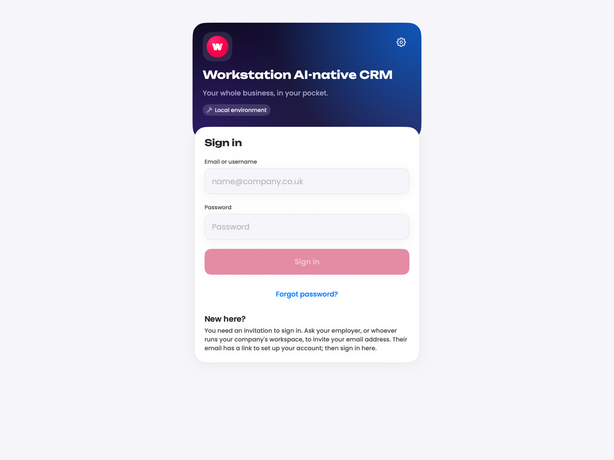
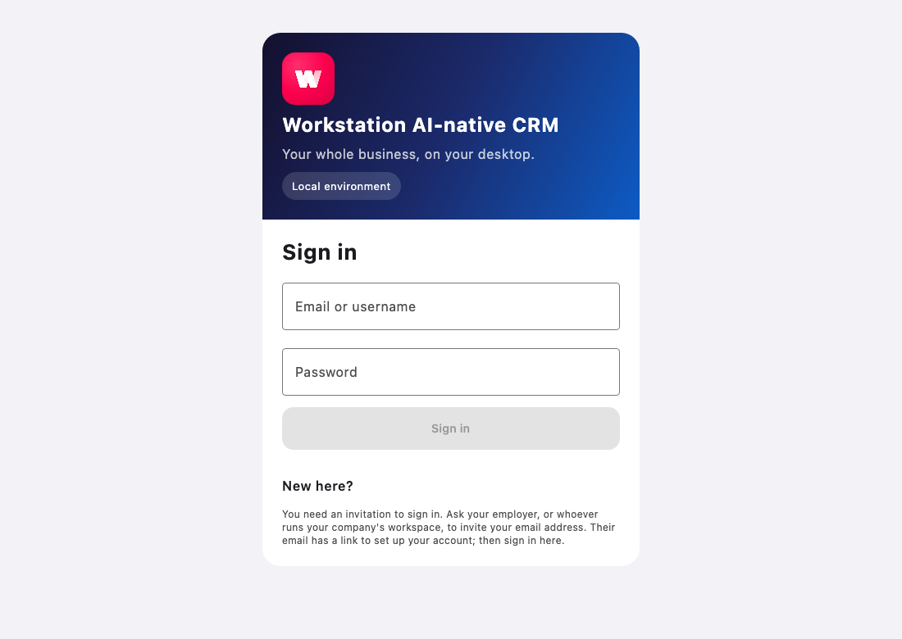

# Desktop apps (macOS and Windows)

The desktop apps follow the same rule as the phone apps: **native only**. No web views, no web
dashboard in a window, no Electron. Each desktop app is built from code we already have.

| Platform | How | Code it reuses | State |
|----------|-----|----------------|-------|
| macOS | The iOS app, built for **Mac Catalyst** | All of `WSLCRM/` (SwiftUI) | Builds and runs (checked with `WSLCRM-Local`; CI builds `WSLCRM-Int`) |
| Windows | **Compose Multiplatform Desktop** (JVM), `android/desktop` | The platform-free Kotlin in `android/app` | Sign-in proof; screens still to build |




## macOS: Mac Catalyst

### Why Catalyst

| Option | Verdict |
|--------|---------|
| **Mac Catalyst** (chosen) | The whole app (about 490 Swift files) builds for the Mac with **one** `#if` guard. Real Mac app: resizable windows, menu bar, keyboard and pointer, Touch ID, Intel and Apple silicon, Developer ID or Mac App Store. |
| "Designed for iPad" on Apple silicon | No code change, but Apple silicon only, iPad-sized window, no Mac menus, App Store only, no direct download. Fine as a stop-gap, not a product. |
| Native macOS SwiftUI destination | Every UIKit bridge (photo pickers, document camera, `UIViewControllerRepresentable`s, `UIApplication`, haptics, about 40 files import UIKit) would need an AppKit twin. Months of work for little gain over Catalyst. Revisit only for a Mac-first redesign. |

### What differs on the Mac

| Feature | iOS framework | On the Mac |
|---------|---------------|------------|
| Till / product barcode scanning | VisionKit `DataScannerViewController` | Not on the Mac. `POSScannerView.isAvailable` is false, so the Scan button is hidden; type the code into search or use a USB scanner, which types it. The only compile guard in the app (`#if targetEnvironment(macCatalyst)`). |
| Document scanning (bank statements, portal documents) | `VNDocumentCameraViewController` | Compiles; `isSupported` is false on the Mac, so the existing fallback (choose a file or photo) is shown. |
| Face ID | LocalAuthentication | Touch ID on Macs that have it (`BiometricGate` already handles `.touchID`); otherwise the password. |
| Location (site check-in) | CoreLocation | Works with Wi-Fi location; asks for permission as on iOS. |
| Push | APNs | Works once the App ID has Push for Mac Catalyst (same `aps-environment`). |
| Alternate app icons | `setAlternateIconName` | Not supported on the Mac: `supportsAlternateIcons` is false and Appearance says so when one is picked. |
| Camera, microphone, photos, speech | AVFoundation, PhotosUI, Speech | Work, with the Mac's camera and microphone. |
| Haptics | UIKit feedback generators | Silently do nothing. |

### Build

```bash
xcodegen generate
xcodebuild -project WSLCRM.xcodeproj -scheme WSLCRM-Local \
  -destination 'platform=macOS,variant=Mac Catalyst' build CODE_SIGNING_ALLOWED=NO
# Local stack on another port:  ... LOCAL_API_PORT=4012
# The app: DerivedData/.../Build/Products/Debug-Local-maccatalyst/WSLCRM.app
```

Or in Xcode pick the scheme and **My Mac (Mac Catalyst)**. `project.yml` sets
`SUPPORTS_MACCATALYST: YES`, keeps the iOS bundle ID on the Mac (so one App Store record and
universal purchase), and uses `WSLCRM/Resources/WSLCRM-macOS.entitlements` for Mac builds: the App
Sandbox (required for the Mac App Store and TestFlight for Mac) with network, camera, microphone,
location, photos and user-chosen files.

Unsigned builds (`CODE_SIGNING_ALLOWED=NO`) start and show the sign-in screen, but the keychain is
only reliable in a signed build (the sandbox keychain needs the app's team ID), so sign in with a
signed Debug build from Xcode.

### Auth and API

Unchanged from iOS, because it is the same code: the JWT pair in the Keychain
(`KeychainStore`, this-device-only), refresh on 401, `X-Namespace-Id`, https only with plain http
allowed for `127.0.0.1`/`localhost` in the Local configuration only (`Info-Local.plist`), and the
build-time "Validate API base URL" phase.

## Windows: Compose Multiplatform Desktop

### Why Compose Desktop

There is no SwiftUI on Windows, so the Windows app reuses the **Kotlin** code from the Android app.
Compose Multiplatform runs the same Jetpack Compose UI code on the JVM and draws it with Skia: a
native window, not a browser.

| Option | Verdict |
|--------|---------|
| **Compose Multiplatform Desktop** (chosen) | Reuses Android's Kotlin (networking, models, API clients, permissions, Compose components) as is. Packages to `.msi` (and `.dmg`/`.deb`). |
| WinUI 3 / .NET MAUI | A third codebase in C#; nothing shared. |
| Flutter | A rewrite in Dart; nothing shared. |
| Swift on Windows | Swift compiles on Windows, SwiftUI does not; the UI would be rewritten anyway. |
| Electron / Tauri / any web wrapper | **Rejected**: a web app in a window breaks the native-only rule. |

### How much of `android/` it can share

`android/app/src/main` is 55 Kotlin files, about 9,400 lines.

| Part | Lines (approx.) | Status |
|------|-----------------|--------|
| Networking (`APIClient` on OkHttp, errors, envelopes, JSON, retry), auth API and models, tokens, permissions, events, pending mutations, Kanban/projects models and API, shared Compose components (`Components.kt`, `Tone.kt`, `LoadState.kt`) | 2,900 (20 files) | **Shared now**, compiled into the desktop app unchanged |
| Shop back office screens and models, `SessionStore`, offline queue and cache, `Formatters` | about 4,500 | Compose and plain Kotlin; need small splits (`android.util.Log`, `Context` file paths, `DateUtils`, `navigation-compose` to the multiplatform navigation, `ShopAPI`'s `AppContainer` helper) |
| Android only: `MainActivity`, `AppContainer`/`AppConfig`/`Brand` (BuildConfig, R), Keystore, SharedPreferences, `BiometricPrompt`, location, connectivity | about 1,000 | Desktop versions needed: OS credential store (done), a preferences file, Windows Hello later, `java.net` reachability |
| `WebPageScreen` / `WebSession` (dashboard pages in a WebView) | about 400 | **Never ported**: web pages are not allowed in the desktop app |

Room, CameraX, Firebase and Retrofit are not used, which keeps the port simple.

The bigger gap is coverage, not portability: the Android app is about 5% of the iOS app (it has
the shop natively and opens other modules as web pages). The Windows app must build each module's
screens natively, the same work as bringing Android to parity, and it should be done **once in
shared Kotlin** for both.

### How sharing works today

`android/desktop/build.gradle.kts` copies the listed platform-free files from `android/app` into
the desktop build (a Gradle `Sync` into `build/`), so the Android app is untouched and there is one
copy of each file to edit. The two places where shared code touches the platform have a file of the
same name in each app, the hand-written equivalent of Kotlin Multiplatform's `expect`/`actual`:

- `core/platform/PlatformLog.kt`: logcat on Android, stderr on desktop.
- `designsystem/Theme.kt`: Android reads brand colours from `R`; desktop writes them in.

Token storage: `core/auth/AuthTokens.kt` (shared interface) with `KeystoreTokenStore` on Android and
`DesktopTokenStore` on desktop, which keeps the JWT pair in **Windows Credential Manager** (macOS
Keychain / Linux Secret Service elsewhere), never in a file.

Next step: move the shared files into a Kotlin Multiplatform `:shared` module (`commonMain` +
`androidMain` + `desktopMain`, real `expect`/`actual`) used by both `:app` and `:desktop`, and
build new module screens there.

### Build

```bash
cd android
./gradlew :desktop:test                       # unit tests + renders build/desktop/desktop-compose-signin.png
./gradlew :desktop:run                        # run it (int API)
./gradlew :desktop:run -Pwslcrm.desktopApiBaseUrl=http://127.0.0.1:4011    # a local stack
./gradlew :desktop:packageDistributionForCurrentOS   # .msi on Windows, .dmg on macOS, .deb on Linux
```

JDK 17. The Android SDK is not needed for the desktop tasks. `:desktop:run` needs a desktop session
(it fails as "headless" from a sandboxed or remote shell; run the packaged app instead). The API
address follows the same rule as iOS and Android: https, or plain http only for
`127.0.0.1`/`localhost`; anything else fails the build. The `.msi` can only be built on Windows
(jpackage builds for the OS it runs on); `.github/workflows/desktop.yml` builds it on
`windows-latest` and uploads it as an artifact.

Icons come from the iOS app icon: `android/desktop/icons/make-icons.sh` writes `wslcrm.ico`,
`wslcrm.icns` and `wslcrm.png`.

## Release

Nothing here is wired to a release job yet. A merge to `main` still only uploads the iOS app to
TestFlight.

### macOS

Recommended: **TestFlight for Mac, then the Mac App Store**, on the same App Store Connect record
as iOS (the bundle ID is shared, so this is universal purchase). Testers already on TestFlight get
the Mac build in the TestFlight Mac app, and updates are automatic.

1. In the Apple Developer account, enable **Mac Catalyst** on the `uk.co.workstation.wslcrm` App ID
   with Push Notifications; regenerate the match/App Store profiles to include the Mac.
2. Add a `mac` lane to `fastlane/Fastfile`: `build_mac_app(scheme: "WSLCRM-Prod",
   destination: "platform=macOS,variant=Mac Catalyst", export_method: "app-store")`, then
   `upload_to_testflight(app_platform: "osx")`.
3. Add it to `ios_release.yml` once the Mac build has been tried by hand.

For direct download instead (no store): sign with a **Developer ID Application** certificate,
notarise with `xcrun notarytool` and staple, ship a `.dmg`, and use **Sparkle** for updates
(an appcast hosted on our site, EdDSA-signed updates).

### Windows

Recommended: **MSIX through the Microsoft Store** (Store-managed updates, and the Store signs the
package, so no certificate purchase), with **winget** for people who install from the command line.
For direct download with auto-update, **Conveyor** (Hydraulic) packages Compose Desktop apps as
self-updating MSIX and handles signing; the plain jpackage `.msi` built today has no updater.

Signing: an unsigned `.msi` triggers SmartScreen. Outside the Store, sign with an
**OV/EV code-signing certificate** (now issued on a hardware token or a cloud HSM such as Azure
Trusted Signing) using `signtool` in the Windows job.

## Known limitations

- Windows: only sign-in (password + emailed 2FA), workspace and the server's module list. Modules
  are listed as "Coming to desktop", never opened as web pages. No offline queue, no Windows Hello
  yet. The user agent still says `WSLCRM-Android`.
- Windows: the shop screens are not shared yet (see the table above).
- Mac: no live barcode scanner; no alternate app icons; layouts are the iPad ones (Catalyst
  "Scaled to match iPad"). Switching to "Optimize for Mac" later gives native-size controls but
  needs a layout pass.
- Mac: an unsigned build's keychain is unreliable, so a real sign-in needs a signed build.
- Neither desktop app is signed or released; certificates and store records are still needed.
